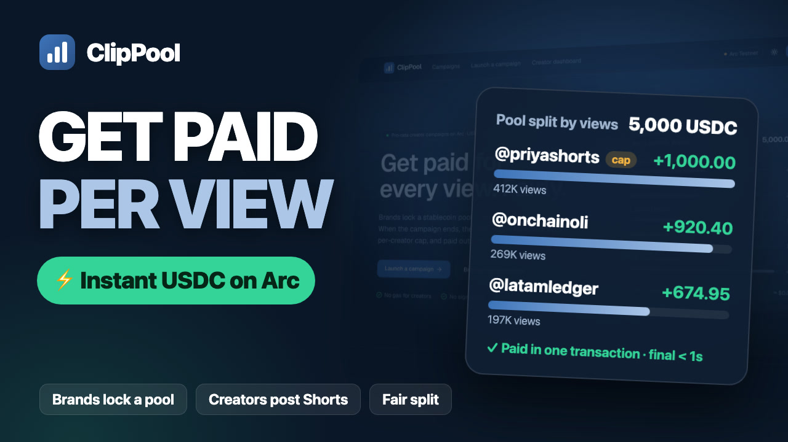

# ClipPool

**Get paid for every view. Fairly.** Pro-rata creator campaigns on [Arc](https://arc.io), Circle's stablecoin-native L1.

A brand locks a USDC (or EURC) pool onchain. Creators post YouTube Shorts for the campaign. When it ends, the pool is
split **by views** — with a per-creator cap — and paid to every creator's wallet in USDC, final in under a second.

[](https://youtu.be/6AJOfA3wmtU)

▶️ **[Watch the 2½-minute demo](https://youtu.be/6AJOfA3wmtU)** — a brand funds a campaign, a creator submits a real Short, and the pool is paid out onchain.

> Status: **live on Arc mainnet** at **https://clippool.fun** · contract [`0xDb22…Dfb9`](https://explorer.arc.io/address/0xDb224b1b1dA608d51d5D6D5C492d083c80F2Dfb9) (verified) · launch campaign live: [clippool.fun/c/1](https://clippool.fun/c/1) · proven end-to-end on testnet ([runbook](docs/runbooks/mainnet.md)). Built for [Arc Microgrants](https://dorahacks.io/hackathon/arc-microgrants/detail).

---

## Why

Brands already pay clippers per view (Whop Content Rewards has paid out ~$2.6M; MrBeast's Vyro pays $3 / 1k views).
Today's model has three flaws:

1. **First-come budget drain** — fixed-CPM budgets run out; late creators with great posts earn nothing.
2. **Opaque payouts** — the platform decides what counts and pays via Stripe, which doesn't reach every country
   where clippers work.
3. **Rejection incentive** — when rejecting a submission saves the brand money, creators carry the risk.

ClipPool fixes all three with a **pro-rata pool escrowed onchain**: the budget is always fully and fairly spent, the
brand can't claw it back, and rejecting a creator saves the brand nothing — their share goes to the other creators.

## How it works

```
Brand ── permit + createCampaign (1 tx) ──▶ ┌────────────────────┐
                                             │  ClipPool.sol      │ ◀── postRoot (oracle)  ─┐
Creator ── Connect YouTube / binding code ─▶ │  (Arc, USDC/EURC)  │ ◀── cancelRoot (guardian)│
          └── submit Short (no gas) ──▶ API  │                    │ ◀── claimMany (keeper)   │
                                             └─────────┬──────────┘                          │
                                     USDC to every creator, final <1s        snapshot views → water-filling
                                                                              allocation → Merkle root
```

1. **Brand** creates a campaign — pool, window, measurement delay, per-creator cap, min views, rules (hash pinned
   onchain) — and funds it in **one transaction** with an EIP-2612 permit.
2. **Creators** prove they own their channel (**Connect YouTube**, read-only OAuth) — or put a per-campaign binding
   code in the description — and submit Shorts. No gas, no signup beyond a wallet; a wallet can be created with
   Google via **Circle user-controlled wallets**.
3. **Snapshot**: after the window, the oracle fetches final views, computes a deterministic **water-filling
   pro-rata split** (bigint math, per-wallet cap, leftover refunded), and posts the **Merkle root** of payout amounts.
4. **Dispute window** (48h on mainnet): a guardian can cancel a bad root; anyone can recompute it from the published
   snapshot with the CLI.
5. **Payout**: the keeper pushes every claim with `claimMany` — each creator is paid in USDC on Arc, no claiming needed.
   One bad recipient (e.g. a blocklisted address) can't block the batch.

## Why Arc

| Arc feature | How ClipPool uses it |
|---|---|
| **USDC as gas, stable ~$0.001 fees** | Paying hundreds of creators a few cents each is economical; brands pay gas in the USDC they already hold. |
| **Sub-second deterministic finality** | Payouts are final the moment they land — no confirmations, instant creator UX. |
| **Native USDC + EURC (FiatToken v2, EIP-2612)** | One-transaction permit funding; EUR-denominated campaigns. |
| **Circle user-controlled wallets on `ARC`** | Creators without crypto wallets get an Arc wallet with Google sign-in. |
| **Arc Foundry** | Fork tests against real Arc state: USDC permit, the 6-dp ERC-20 / 18-dp native dual interface, blocklist precompile. |

## Deployments

| Network | ClipPool | Windows |
|---|---|---|
| Arc testnet (5042002) | [`0x50519aFfe82591afd402c7F22ad9BC6DD2d86030`](https://explorer.testnet.arc.io/address/0x50519affe82591afd402c7f22ad9bc6dd2d86030) (verified) | dispute 10 min · min measurement 5 min |
| Arc mainnet (5042) | [`0xDb224b1b1dA608d51d5D6D5C492d083c80F2Dfb9`](https://explorer.arc.io/address/0xDb224b1b1dA608d51d5D6D5C492d083c80F2Dfb9) (verified) | dispute 48 h · min measurement 1 h |

## Trust model

| Component | Trust |
|---|---|
| Pool custody, payout limits, refunds | **Trustless** — enforced by `ClipPool.sol` (`claimed ≤ totalAllocated ≤ pool`; brand can't withdraw a live pool; full refund if no root within 14 days). |
| Which submissions count + view counts | **Oracle** (v1), mitigated by a published snapshot, a deterministic open-source allocation script, and the dispute window. |
| View authenticity (bots) | Heuristics in v1 (per-creator cap, min views, channel age ≥ 30 days). v2: engaged-view metrics via creator-authorized YouTube Analytics / zkTLS. |

Raw YouTube statistics never go onchain (YouTube API policy: ≤ 30 days storage) — only payout amounts and a snapshot hash.

## Repository

```
contracts/            Foundry — ClipPool.sol, unit/fuzz/invariant/fixture/Arc-fork tests, deploy script
packages/allocation/  TypeScript allocation engine + Merkle tree + `verify` CLI (golden fixtures shared with Solidity)
apps/web/             Next.js 16 app + API: campaigns, submissions, YouTube, Circle wallets, oracle/keeper/sync jobs
media/short/          Remotion sources: explainer Short, product demo video (voiceover-synced timeline), YouTube thumbnail
docs/plans/           spec, plan, shared interfaces · docs/research/ idea research
.github/workflows/    CI + cron scheduler (oracle, keeper, sync, view refresh, 30-day purge)
```

## Quickstart

Requirements: Node 22+, pnpm 8+, [Foundry](https://getfoundry.sh) (+ [Arc Foundry](https://docs.arc.io/arc/tutorials/install-arc-foundry) for fork tests).

```bash
pnpm install
cp .env.example .env          # fill the [T] keys for testnet; see comments in the file
```

**Try the UI with sample data (no keys):**

```bash
NEXT_PUBLIC_USE_MOCKS=1 pnpm --filter web dev
```

**Tests:**

```bash
cd contracts && forge test                                                   # contract suite
arc-forge test --match-contract Fork --fork-url https://rpc.testnet.arc.io   # Arc fork tests (local simulation)
pnpm --filter @clippool/allocation test                                      # allocation engine
cd apps/web && pnpm test                                                     # API / server / client
```

**Testnet, end to end:**

```bash
cd contracts && arc-forge script script/Deploy.s.sol:Deploy --rpc-url $ARC_TESTNET_RPC_URL --broadcast \
  --with-gas-price 25gwei --priority-gas-price 1gwei --verify --verifier blockscout \
  --verifier-url https://explorer.testnet.arc.io/api/
cd ../apps/web
pnpm fund:testnet --send          # spread faucet USDC to oracle / keeper / test-brand wallets
pnpm e2e:testnet                  # scripted campaign: permit create → root → claimMany → refund, verified onchain
npx drizzle-kit migrate && pnpm dev
pnpm campaign:testnet --title "My campaign" --pool 2 --minutes 120   # live campaign for real Shorts
```

## Verify a split yourself

Every campaign publishes its snapshot (inputs + allocation) for 30 days. Recompute the root and compare it with the
one onchain:

```bash
pnpm --filter @clippool/allocation verify snapshot.json --rpc https://rpc.testnet.arc.io --address <ClipPool>
```

## Roadmap

- Mainnet pilot with Arc ecosystem brands.
- Engaged-view metrics (YouTube Analytics with creator consent, zkTLS) for bot resistance.
- TikTok / Instagram Reels; per-video measurement windows; CPM-then-pro-rata hybrid campaigns.
- Brand-signed campaign metadata; Google OAuth app verification for public Connect YouTube.

## License

TBD.
